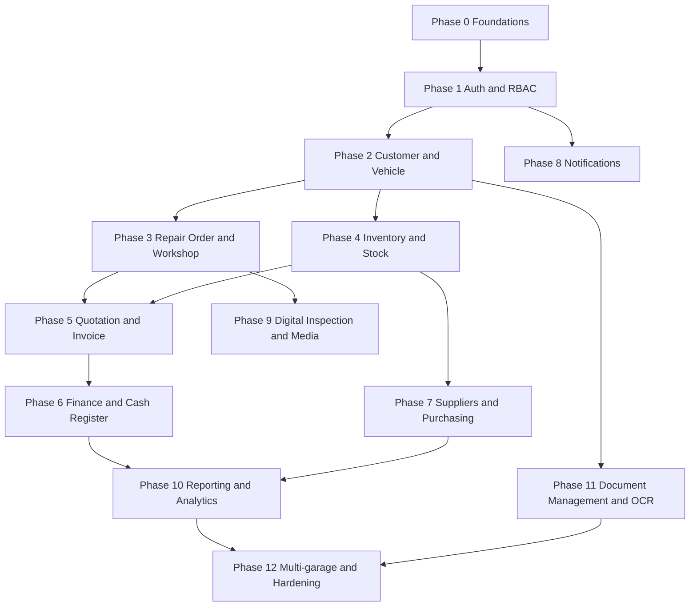

# 00 — Plan of Execution

This document is the master roadmap for Xpert-ERP. It defines phases, sequence, gates between phases, and the headline timeline. Detailed scope, exit criteria, and effort estimates per milestone live in [02_MILESTONES.md](02_MILESTONES.md).

---

## 1. Delivery strategy

The project is delivered in **incremental, modular phases**. Each phase produces a vertically-integrated slice — database, API, frontend, tests, docs, and deployment — for one or more modules. The system is **always shippable** at the end of each phase, behind feature flags for unfinished modules.

Rationale:

- The business flow has hard sequencing (Customer → Vehicle → Repair Order → Invoice → Payment → Delivery). Modules earlier in the chain are prerequisites for later ones.
- Stable foundations (auth, RBAC, audit, logging, document numbering) compound: building them late causes cascading rework.
- Reporting and analytics only become useful once the operational modules generate data; pushing them late is correct.

Three trunks run in parallel after Phase 0:

- **Foundation trunk** — auth, RBAC, audit, logging, document templates, notifications, security, backup.
- **Operational trunk** — customer, vehicle, repair order, inspection, workshop, inventory.
- **Financial trunk** — quotation, invoice, payment, cash register, supplier, accounting export.

The reporting module sits on top of all three.

---

## 2. Phase overview

| # | Phase                                  | Modules introduced                                                                 | Duration (PW) |
|---|----------------------------------------|------------------------------------------------------------------------------------|---------------|
| 0 | Foundations                            | Repo, CI/CD, DB skeleton, logging, config, base UI shell                            | 3             |
| 1 | Authentication and RBAC                | User, Role, Permission, Audit log                                                  | 3             |
| 2 | Customer and Vehicle                   | Customer (CRM core), Vehicle records, document upload (GED entry point)            | 4             |
| 3 | Repair Order and Workshop              | Repair Order, mechanic assignment, status workflow, time tracking, photos          | 5             |
| 4 | Inventory and Stock                    | Parts catalog, stock movements, reservations, low-stock alerts                     | 4             |
| 5 | Quotation and Invoice                  | Quotation, invoice, VAT, discounts, document numbering, PDF generation             | 5             |
| 6 | Finance and Cash Register              | Payments (cash, card, transfer, cheque), partial payments, deposits, cash closing  | 4             |
| 7 | Suppliers and Purchasing               | Supplier, purchase request, purchase order, reception, supplier invoice            | 4             |
| 8 | Notifications and Reminders            | SMS/email, reminder schedules, template editor, delivery log                       | 3             |
| 9 | Digital Inspection and Media           | Checklist templates, photo/video upload, diagnostic report PDF, customer approval  | 3             |
| 10| Reporting and Analytics                | KPI dashboard, exports (PDF/Excel), accounting export (CSV/Excel)                  | 4             |
| 11| Document Management (GED) and OCR      | Document categorization, archival, PaddleOCR ingest for registration cards and IDs | 4             |
| 12| Multi-garage and hardening             | Garage tenancy, performance hardening, security audit, load tests, prod readiness  | 4             |

**Total nominal effort:** 50 person-weeks for one senior full-stack engineer. With two engineers running the trunks in parallel from Phase 2 onward, the calendar collapses to roughly **30–34 calendar weeks**. The parallelism matrix in [02_MILESTONES.md](02_MILESTONES.md) shows where slots can overlap.

---

## 3. Sequence and dependencies

A phase can begin as soon as all its upstream phases have passed their **exit gate**. See section 5.

---

## 4. MVP definition

The Minimum Viable Product covers **Phases 0 through 6**. At MVP, the garage can:

- Authenticate users with role-based access.
- Manage customers and vehicles.
- Create a repair order, assign a mechanic, track status, attach photos.
- Manage parts inventory with stock movements and reservations.
- Generate a quotation, convert to invoice, apply VAT and discount.
- Record payments (cash, card, transfer, cheque), handle partial payments and deposits, close the cash register at end of day.

Phases 7–12 are post-MVP value adds and may be reordered based on customer feedback, but the sequence above is the recommended default.

---

## 5. Exit gates

A phase only passes when all the following are green:

1. **Functional acceptance** — the user stories listed in [02_MILESTONES.md](02_MILESTONES.md) are demonstrable in a staging environment.
2. **Tests** — unit, integration, and end-to-end tests for new code pass; coverage on new code is at or above the project threshold (see [09_TESTING_STRATEGY.md](09_TESTING_STRATEGY.md)). Test reports are stored in `docs/tests/testForFeatureX/` per [Context.md](Context.md).
3. **Documentation** — every implemented feature has a corresponding entry in `docs/feature/featureName/` per [Context.md](Context.md).
4. **Performance** — typical operations (list, search, document generation) complete in under 2 seconds at the target data volume.
5. **Security** — no critical findings from automated scans; audit log entries are produced for sensitive actions in scope.
6. **Stability** — current branch merged to `stable-testing` only after at least 48 hours of soak with no critical defects.

---

## 6. Cross-cutting workstreams

These streams are active across every phase and have their own owners and rhythms:

- **Architecture stewardship** — keep [03_ARCHITECTURE.md](03_ARCHITECTURE.md) and the ERD in sync with code.
- **Security** — RBAC reviews, audit log coverage, dependency scans (Dependabot or equivalent), secrets hygiene.
- **Observability** — per-component logging per [Context.md](Context.md), metrics, traces. Each module emits structured logs to its own log file.
- **Quality** — test pyramid maintenance, flaky-test triage, performance baselines.
- **Documentation** — `docs/feature/`, `docs/tests/`, `docs/bugs/` are the canonical homes; this `projectContext/` folder is for design and planning artefacts only.

---

## 7. Risks influencing the plan

The high-impact risks that could reshape the schedule are listed in [11_RISK_REGISTER.md](11_RISK_REGISTER.md). The three that most often dominate this kind of project:

- **OCR accuracy** for registration cards and IDs is variable; Phase 11 may need extra time for tuning and human-in-the-loop review.
- **Accounting export format** depends on the target accounting software (Sage, Cegid, EBP, etc.). Phase 10 needs the target chosen before scoping freezes.
- **Multi-garage tenancy** is invasive if added late. Even though it is Phase 12, schema choices in Phase 0 must already support a future `garage_id` discriminator (see [04_DATABASE_DESIGN.md](04_DATABASE_DESIGN.md)).

---

## 8. Calendar template

The calendar template below assumes a 2 PW per calendar week capacity (two engineers, parallelizable trunks). Adjust if team size differs.

| Calendar week | Phase(s) running                          | Notable gate              |
|---------------|-------------------------------------------|---------------------------|
| W1–W2         | P0 Foundations                            | Repo, CI, base shell      |
| W3–W4         | P1 Auth and RBAC                          | Login works               |
| W5–W7         | P2 Customer and Vehicle                   | First end-to-end create   |
| W8–W11        | P3 Repair Order + P4 Inventory (parallel) | OR lifecycle, stock moves |
| W12–W14       | P5 Quotation and Invoice                  | First invoice generated   |
| W15–W17       | P6 Finance + P8 Notifications (parallel)  | MVP gate                  |
| W18–W20       | P7 Suppliers + P9 Inspection (parallel)   |                           |
| W21–W23       | P10 Reporting                             | Dashboard live            |
| W24–W26       | P11 Document Management and OCR           | OCR pipeline live         |
| W27–W30       | P12 Multi-garage and hardening            | Production ready          |

Dates are deliberately omitted from this document — they belong in the project tracker and will drift; the **sequence** is the durable artefact.
