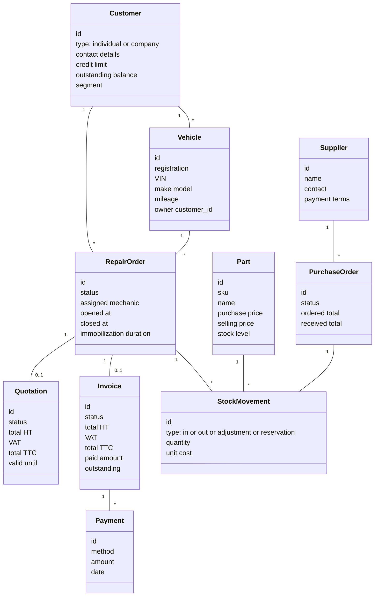
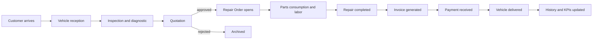

# 01 — Software Conception

The conception of the system: what it is, what it is not, the principles it follows, and the constraints under which it must operate.

---

## 1. Product vision

A modern, web-based **Garage / Dealer Management System (GMS/DMS)** that centralizes and automates the operations of an automotive repair workshop:

- workshop and repair lifecycle
- invoicing and quotations
- inventory and spare parts
- customer relationship management
- finance and cash register
- reporting and analytics
- document archival and OCR-driven ingestion

The product must be usable on **desktop** by reception and admin, and on **tablet** by mechanics in the workshop. Mechanics must be able to upload photos and videos from their phones or tablets.

---

## 2. Out of scope (explicit)

The following are deliberately excluded from the initial scope and called out so they are not assumed:

- Native mobile applications (iOS or Android). The web app must be responsive enough for tablets, but no compiled mobile binaries are in scope.
- Telemetry from on-board diagnostics (OBD-II) or vehicle scanners.
- A customer-facing public portal beyond receiving email/SMS notifications and approving quotations via signed link.
- Marketing automation beyond simple segmentation and templated bulk email/SMS.
- Tax filing or formal accounting bookkeeping. The system **exports** to accounting software but does not replace it.

---

## 3. Design principles

These are non-negotiable principles that any future change must respect.

1. **Modular and incremental delivery.** Each module is a vertical slice with its own contract. Modules are wired via an explicit application layer; they never reach into each other's database tables.
2. **No hard-coded values.** Per [Context.md](Context.md). Anything that could change between deployments or over time (thresholds, VAT rates, document number formats, reminder delays, retention windows, file size caps) is configuration, not code. See section 7.
3. **Per-component logging.** Per [Context.md](Context.md). Each component (`auth`, `customer`, `repair_order`, `inventory`, `invoice`, `payment`, `ocr`, etc.) writes to its own structured log file with consistent fields (timestamp, level, request_id, user_id, garage_id, component, event, data).
4. **Edge cases are part of the feature.** A feature is not done until its edge cases are explicitly considered (empty state, concurrent edit, partial failure, network loss on mobile, missing data, locale and currency edge cases). See [09_TESTING_STRATEGY.md](09_TESTING_STRATEGY.md).
5. **Production-ready from day one.** No throwaway code in `main`. Branches: `main` for current development integration, `stable-testing` for stable versions only, feature branches for unmerged work.
6. **Auditability.** Every sensitive action (invoice modification, stock adjustment, deleted repair order, payment cancellation, permission change) writes an audit log entry with `user_id`, `timestamp`, `old_value`, `new_value`, `reason` where applicable.
7. **Tenancy-ready from day one.** Even though multi-garage is Phase 12, every primary table carries a `garage_id` from the start. The MVP runs as a single-tenant deployment with a default garage, and the column is honest, not theatrical — all queries filter by it.
8. **Optimistic concurrency.** Repair orders, quotations, invoices, and stock movements use a `version` column with `If-Match` semantics on the API so concurrent edits surface a 409 rather than silently overwriting.
9. **Document numbering is monotonic and gap-free per type, per year, per garage.** Numbers are issued by a dedicated `document_sequence` service with a transactional lock; they are never derived from `MAX(id)+1`.
10. **All money is integer minor-units.** Amounts are stored as `BIGINT` in the smallest currency unit (cents/centimes) with a `currency` code; never as `FLOAT`. VAT is computed on totals using banker's rounding.
11. **Soft delete with a hard delete window.** Operational entities (customer, vehicle, repair order, invoice, quotation) are soft-deleted by default. A scheduled job purges soft-deleted records after the legally-required retention window (configurable; see CFG_RETENTION_*).

---

## 4. Quality attributes (non-functional requirements)

| Attribute        | Target                                                                                                |
|------------------|-------------------------------------------------------------------------------------------------------|
| Performance      | Typical interactive request < 2s p95 at expected workshop volumes (see capacity assumptions section). |
| Availability     | 99.5% monthly availability for a single-garage deployment.                                            |
| Durability       | Daily cloud backup with point-in-time recovery up to 7 days.                                          |
| Security         | OWASP ASVS Level 2 alignment; secure auth, password hashing with Argon2id, JWT or session cookies with rotation. |
| Scalability      | Vertical scale for one garage; horizontal scale at the API layer once multi-garage is enabled.        |
| Maintainability  | New developer can run the stack locally and ship a small change within 1 working day.                 |
| Observability    | Per-component log files, request_id propagation, basic metrics (request count, latency, error rate).  |
| Accessibility    | WCAG 2.1 AA target on the reception and admin UIs.                                                    |
| Internationalization | French as the default UI language; system designed for future locale switching; all user-facing strings externalized. |

### Capacity assumptions (used to size the system and validate < 2s p95)

These are explicit assumptions, not measurements. They must be revisited before production.

- One garage: up to **30 active repair orders / day**, **300 invoices / month**, **2,000 customers**, **5,000 vehicles**, **20,000 parts SKUs**, **200,000 stock movements / year**.
- Concurrent users per garage: **10** typical, **25** peak.
- Photo and video storage: up to **1 GB / repair order**, archived to object storage after 90 days (configurable).

---

## 5. Architectural style

A **modular monolith** with clean module boundaries, designed so that any module can later be carved out into a service without rewriting business logic.

- One FastAPI process exposes one API; modules live inside as packages with their own routers, services, repositories, and tests.
- Modules talk to each other through service interfaces, never through cross-module SQL joins. Read views that need joined data are explicit projections owned by the module that exposes them.
- The frontend is a single React SPA consuming the API; it is route-split per module for code-splitting.

Why a modular monolith, not microservices from day one:

- The team size is small. Microservices multiply ops cost and contract management overhead.
- Latency and consistency are simpler in one process. Cash register and stock reservation, in particular, benefit from a single transaction boundary.
- The migration path to services is available later — clean module boundaries are the cost we pay now to keep that option open.

See [03_ARCHITECTURE.md](03_ARCHITECTURE.md) for the structural diagrams.

---

## 6. Domain model overview

Two diagrams describe the core domain. The full ERD is in [04_DATABASE_DESIGN.md](04_DATABASE_DESIGN.md); the diagrams below show the conceptual mental model.

### 6.1 Core aggregates

### 6.2 Lifecycle of the business flow

---

## 7. Configuration parameters (CFG_*)

Every value in the table below is exposed as configuration. The default appears here to document intent; the actual value is loaded from environment, database settings table, or a per-garage settings record.

| Key                              | Description                                                                | Default        |
|----------------------------------|----------------------------------------------------------------------------|----------------|
| CFG_VAT_RATES                    | List of legal VAT rates available for invoicing                            | per locale     |
| CFG_DEFAULT_VAT_RATE             | Default VAT rate applied to new invoice lines                              | locale-dependent |
| CFG_CREDIT_LIMIT_DEFAULT         | Default customer credit limit                                              | currency-dependent |
| CFG_OUTSTANDING_BLOCK_THRESHOLD  | Outstanding balance above which new credit sales are blocked               | currency-dependent |
| CFG_REMINDER_LEVELS              | List of reminder levels with delay in days and template id                 | three levels   |
| CFG_QUOTATION_VALIDITY_DAYS      | Default quotation validity window                                          | 30             |
| CFG_INVOICE_DUE_DAYS             | Default invoice due window                                                 | 30             |
| CFG_LOW_STOCK_THRESHOLD_DEFAULT  | Per-SKU default if not set explicitly                                      | per-SKU only   |
| CFG_DOCUMENT_NUMBER_FORMAT       | Per-document-type sprintf-like format (e.g. INV-{year}-{seq:06})           | configurable   |
| CFG_RETENTION_INVOICE_YEARS      | Legal retention for invoices                                               | 10             |
| CFG_RETENTION_REPAIR_ORDER_YEARS | Retention for repair orders                                                | 5              |
| CFG_RETENTION_CUSTOMER_YEARS     | Retention for inactive customer data                                       | 3 after last activity |
| CFG_PASSWORD_POLICY              | Min length, complexity rules, history, lockout                             | strong default |
| CFG_SESSION_IDLE_TIMEOUT_MINUTES | Inactive session timeout                                                   | 30             |
| CFG_FILE_MAX_SIZE_MB             | Maximum upload size for photo/video                                        | 50             |
| CFG_PHOTO_ARCHIVE_AFTER_DAYS     | Move photos from hot storage to archive bucket                             | 90             |
| CFG_OCR_CONFIDENCE_THRESHOLD     | Below this, OCR result requires human validation                           | 0.85           |
| CFG_KPI_REFRESH_INTERVAL_SECONDS | How often dashboard KPIs are recomputed                                    | 60             |

---

## 8. Logging conventions (per component)

Per [Context.md](Context.md), each component logs separately. Structure:

- Format: JSON Lines.
- Required fields: `ts`, `level`, `component`, `event`, `request_id`, `user_id`, `garage_id`.
- One file per component, rotated daily, retained for `CFG_LOG_RETENTION_DAYS` (default 30 in dev, 90 in prod).
- Sensitive fields (passwords, full card data, raw OCR token output) are never logged.

Components that get their own log file:

`auth`, `rbac`, `audit`, `customer`, `vehicle`, `repair_order`, `inspection`, `workshop`, `inventory`, `quotation`, `invoice`, `payment`, `cash_register`, `supplier`, `purchase_order`, `notification`, `document`, `ocr`, `reporting`, `scheduler`, `api_gateway`.

---

## 9. Internationalization and currency

- Primary UI language: **French**. Secondary: **English**. The string catalog uses ICU MessageFormat.
- Currency is per-garage and defaults to the locale's currency. Amounts are stored as integer minor units. The display layer formats with the user's locale.
- Dates are stored as `TIMESTAMPTZ` in UTC, displayed in the garage's timezone.
- Phone numbers are stored in E.164.

---

## 10. What "done" means for a feature

Per [Context.md](Context.md), a feature is done when:

1. Code is merged to the integration branch and CI is green.
2. Unit and integration tests cover happy path and named edge cases; results stored under `docs/tests/testForFeatureX/`.
3. A feature document exists under `docs/feature/featureName/` with: purpose, user stories, screenshots or wireframes, configuration keys touched, audit events emitted, log events emitted, known limitations.
4. The feature is demonstrable end-to-end in staging.
5. Performance and error budgets are within target.
6. Logs and audit entries are produced where required.

Anything short of this list is "in progress", not done.
