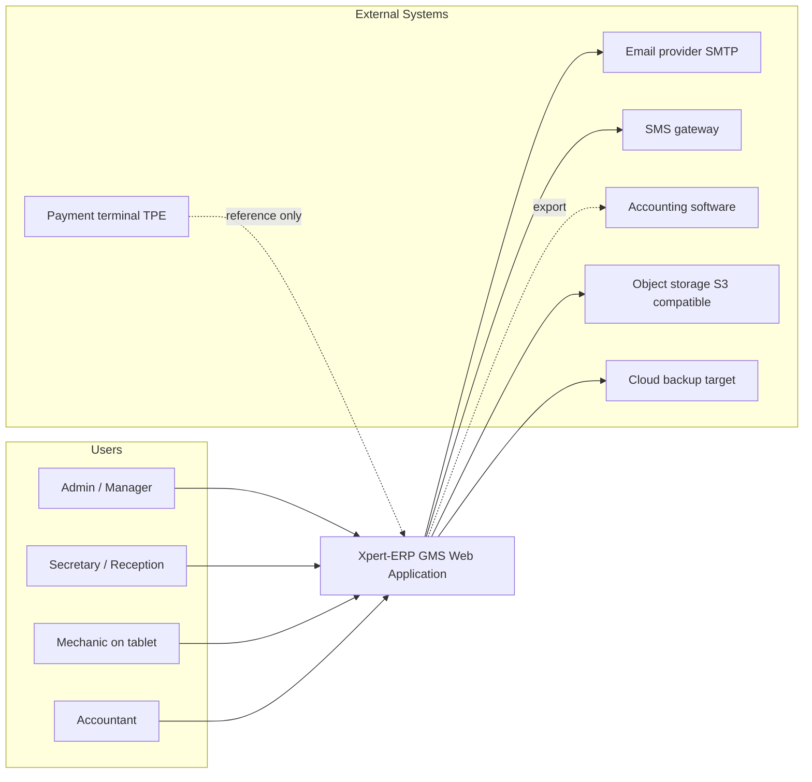
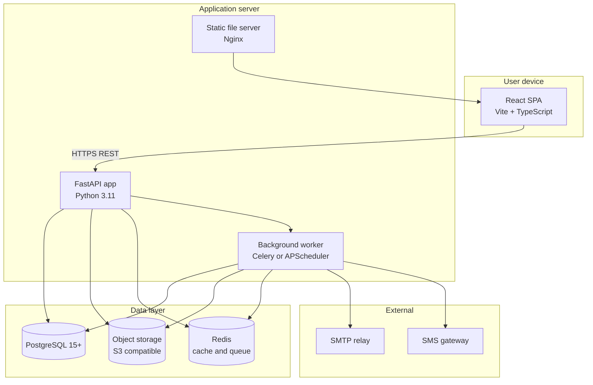
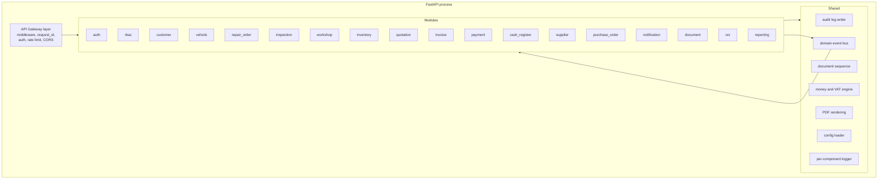
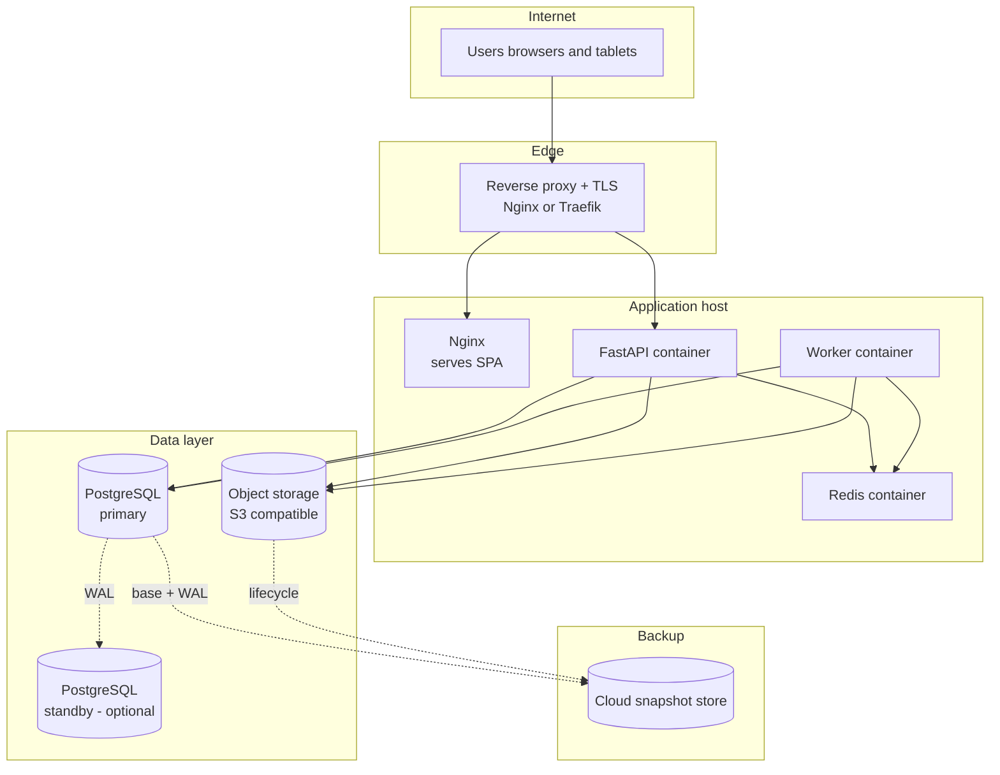
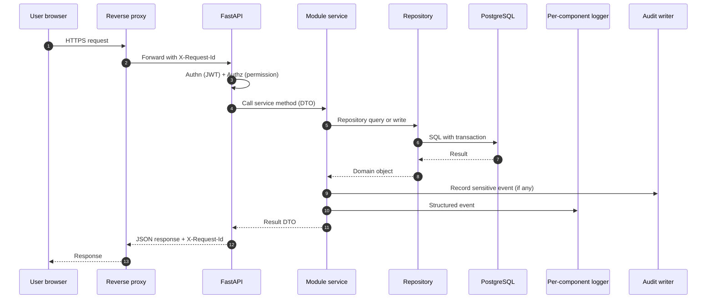

# 03 — Architecture

The architecture of Xpert-ERP at four levels of zoom: context, container, component, and deployment. Inspired by the C4 model.

---

## 1. System context (Level 1)



The TPE (payment terminal) is referenced only — Xpert-ERP records the payment, the actual card transaction happens on the terminal hardware. Future integration with payment gateways is possible but out of scope for v1.

---

## 2. Container view (Level 2)



### Container responsibilities

- **React SPA** — UI, routing, state, optimistic updates, file upload with resume.
- **FastAPI app** — REST API, authn/authz, business logic, transaction boundary, audit and logging.
- **Background worker** — long-running tasks (OCR, PDF generation under load, scheduled reminders, KPI snapshots, backup orchestration).
- **PostgreSQL** — transactional data store, source of truth.
- **Object storage** — photos, videos, PDFs, scanned documents.
- **Redis** — short-lived cache (sessions, KPI cache) and Celery broker if Celery is chosen.
- **Static server (Nginx)** — serves the built SPA, terminates TLS, reverse-proxies the API.

---

## 3. Backend component view (Level 3)

The FastAPI app is a **modular monolith**: each business module lives in its own package with router, service, repository, schemas, and tests.



### Module conventions

Every module package looks like this:

```
backend/app/modules/<module_name>/
    __init__.py
    router.py        # FastAPI APIRouter, mounted under /api/v1/<module_name>
    schemas.py       # Pydantic models for request/response (DTOs)
    service.py       # Business logic; calls repository; emits events; writes audit and log entries
    repository.py    # Data access; SQLAlchemy queries; no business logic
    models.py        # SQLAlchemy ORM models for this module
    events.py        # Domain events emitted and handlers subscribed
    permissions.py   # Permission codes used by this module
    config.py        # Module-specific CFG_* keys
    exceptions.py    # Domain exceptions translated to HTTP by the gateway
    tests/
        unit/
        integration/
```

### Inter-module communication

Modules talk to each other in two ways only:

1. **Service call** — `repair_order.service` calls `inventory.service.reserve_parts(...)`. Synchronous, in-process, in the same transaction.
2. **Domain event** — `invoice.service` publishes `InvoicePaid`. Subscribers (`customer.service` for balance, `reporting.service` for KPI cache invalidation) react. Async via the event bus; if the bus is in-process, subscribers see a consistent view; if it crosses processes (worker), eventual consistency.

No module imports another module's `repository.py` or `models.py`. Crossing that line is a code-review hard stop.

### Shared services

- **audit log writer** — single API: `audit.record(event_type, entity_type, entity_id, before, after, reason)`. Writes to `audit_log` table; never throws (logs are best-effort by design but a failure to record is itself logged as critical).
- **document sequence** — `document_sequence.next(garage_id, doc_type, year)` → string formatted by `CFG_DOCUMENT_NUMBER_FORMAT`. Uses a row-level lock for safety.
- **money and VAT engine** — `Money(amount_minor, currency)` class; `apply_vat(money, rate)`, `apply_discount(money, percent_or_absolute)`. Banker's rounding.
- **PDF rendering** — wraps a templating engine (Jinja2 + WeasyPrint or ReportLab; choice in [08_TECH_STACK.md](08_TECH_STACK.md)). Templates are stored as files with per-garage overrides.
- **config loader** — merges env, db settings table, and per-garage overrides; caches with explicit invalidation hooks.
- **per-component logger** — `logger("invoice").info(event="invoice_issued", invoice_id=..., garage_id=..., user_id=..., request_id=...)`. Each component gets its own file via a logging handler.
- **domain event bus** — in-process pub/sub; events also written to an `outbox` table when delivery beyond the process is needed (Phase 12+).

---

## 4. Frontend component view (Level 3)

```mermaid
flowchart TB
    subgraph SPA[React SPA]
        Router[Router]
        subgraph Shell
            Layout[App layout shell]
            Auth[Auth context]
            Perms[Permission gate]
            Toast[Notifications]
        end
        subgraph Features
            FCust[customer feature]
            FVeh[vehicle feature]
            FRO[repair_order feature]
            FInv[inventory feature]
            FQuot[quotation feature]
            FInvo[invoice feature]
            FPay[payment feature]
            FCash[cash_register feature]
            FSup[supplier feature]
            FInsp[inspection feature]
            FRep[reporting feature]
            FAdmin[admin feature]
        end
        subgraph Shared[Shared infra]
            API[API client<br/>Axios + interceptors]
            Cache[Query cache<br/>TanStack Query]
            Forms[Form layer<br/>React Hook Form + Zod]
            I18n[i18n catalog]
            Theme[Theme tokens]
        end
        Router --> Shell
        Shell --> Features
        Features --> Shared
    end
```



### Frontend conventions

- One feature folder per module: `src/features/<name>/{pages, components, hooks, api, types}`.
- All API calls go through a typed client generated from the OpenAPI schema.
- All forms validate with Zod schemas mirroring the backend Pydantic schemas (generated where possible).
- The Permission gate component reads claims from the auth context and either renders, hides, or renders a "no access" placeholder.
- All amounts pass through a `<Money>` component that formats per locale and currency.

---

## 5. Deployment view (Level 4)

The default single-garage deployment fits on one modest VM. The architecture also runs on Kubernetes when more isolation or scaling is needed; the artefacts are the same containers.



### Environments

| Env             | Purpose                              | Data                            |
|-----------------|--------------------------------------|---------------------------------|
| `local`         | developer machines                   | fixtures, ephemeral             |
| `ci`            | continuous integration               | per-job ephemeral postgres      |
| `staging`       | pre-production smoke and acceptance  | anonymized snapshot of prod     |
| `stable-testing`| stable candidates for prod           | production-like                 |
| `production`    | customer workloads                   | real data, backed up daily      |

See [10_DEPLOYMENT_DEVOPS.md](10_DEPLOYMENT_DEVOPS.md) for the full CI/CD and backup specification.

---

## 6. Cross-cutting concerns

### 6.1 Request flow with audit and logging



### 6.2 Background processing

Long-running or scheduled tasks are owned by the worker:

- OCR pipeline (large image, slow).
- PDF rendering when generated in batch or during cash closing.
- Notification dispatch with retry and backoff.
- Scheduled reminders (CFG_REMINDER_LEVELS).
- KPI snapshot every CFG_KPI_REFRESH_INTERVAL_SECONDS.
- Backup orchestration.

A task is idempotent and replayable. Each task carries a `request_id` to tie its logs back to the originating user action.

### 6.3 Multi-garage tenancy

- Every primary table carries `garage_id` from M0.
- The repository base class injects `WHERE garage_id = :current_garage` into every query.
- Authenticated requests resolve `current_garage` from the JWT claim; super-admins can override via header.
- Static tests verify that no query touches a primary table without a `garage_id` filter (custom lint or test rule).
- Object storage paths are prefixed with `garages/<garage_id>/...`.

### 6.4 Time, locale, currency

- All `TIMESTAMP` columns are `TIMESTAMPTZ`. Server clock is UTC.
- Display uses garage's `timezone` (default `Europe/Paris` until set).
- Currency is per-garage; cross-garage reporting falls back to a reporting currency with stored exchange rates.

### 6.5 File storage

- All blobs go to object storage. The database stores only metadata and a reference key.
- Hot bucket → archive bucket transition after `CFG_PHOTO_ARCHIVE_AFTER_DAYS`.
- Public access is never granted directly; the API issues short-lived signed URLs.

---

## 7. Folder layout (target)

```
Xpert-ERP/
    backend/
        app/
            main.py
            config/
            shared/
                logging/
                audit/
                document_sequence/
                money/
                pdf/
                events/
            modules/
                auth/
                rbac/
                customer/
                vehicle/
                repair_order/
                inspection/
                workshop/
                inventory/
                quotation/
                invoice/
                payment/
                cash_register/
                supplier/
                purchase_order/
                notification/
                document/
                ocr/
                reporting/
            tests/
        alembic/
        pyproject.toml
    frontend/
        src/
            app/
            features/
                <one folder per module>
            shared/
            i18n/
        public/
        package.json
    infra/
        docker/
        k8s/
        terraform/        (optional, post-MVP)
    docs/
        feature/
        tests/
        bugs/
    projectContext/        (this folder)
        diagrams/
```

---

## 8. Why this architecture (decision notes)

- **Modular monolith over microservices** — see [01_SOFTWARE_CONCEPTION.md](01_SOFTWARE_CONCEPTION.md) section 5.
- **FastAPI over Django** — async support, OpenAPI for free, Pydantic alignment with type safety, lighter footprint. Django would also work; the trade-off is admin scaffolding (Django wins) vs. async and lighter API (FastAPI wins). For this product, the API is the heart; FastAPI fits better.
- **PostgreSQL over MySQL** — JSONB, partial indexes, mature concurrency (MVCC), strong constraint support, generated columns. MySQL works but JSONB and partial indexes are decisive for reporting and document metadata.
- **React over Vue/Angular** — team familiarity and ecosystem. Vue 3 would be a fine alternative; Angular is heavier than needed for this scope.
- **TanStack Query over Redux** — server state is the dominant state class; TanStack Query handles cache invalidation, retries, optimistic updates with minimal boilerplate. Redux remains available if local UI state grows complex.
- **Redis** — cache + queue broker. Optional in MVP; required by M8 if Celery is chosen.
- **Object storage (S3-compatible)** — local MinIO in dev, real S3-compatible service in prod. Keeps the database lean and migration to cloud trivial.
