# 04 — Database Design

PostgreSQL 15+. All tables follow shared conventions, then each domain is described separately. The full ERD is split into focused diagrams to keep them legible.

---

## 1. Shared conventions

These conventions apply to every table unless explicitly noted.

- Primary key: `id BIGINT GENERATED BY DEFAULT AS IDENTITY` or `UUID` for entities exposed in URLs. Default to BIGINT internally; expose UUID surrogate where the id would otherwise leak count or order.
- Tenancy: `garage_id BIGINT NOT NULL REFERENCES garage(id)` on every primary table. Required from M0.
- Timestamps: `created_at TIMESTAMPTZ NOT NULL DEFAULT now()`, `updated_at TIMESTAMPTZ NOT NULL DEFAULT now()` (refreshed by trigger).
- Authorship: `created_by BIGINT REFERENCES app_user(id)`, `updated_by BIGINT REFERENCES app_user(id)`.
- Soft delete: `deleted_at TIMESTAMPTZ NULL`, `deleted_by BIGINT NULL`. Indexed where lookups are common.
- Concurrency: `version INT NOT NULL DEFAULT 0`, incremented on update; the API enforces `If-Match`.
- Money: stored as `BIGINT amount_minor` plus `currency CHAR(3)`. Never `FLOAT` or `NUMERIC` for currency-amount columns.
- Snake_case for all schema names.
- All FKs are `ON DELETE RESTRICT` unless explicitly specified — soft-delete is the right tool for cleanups.
- Indexes: every FK gets an index. Tenancy is the leading column for composite indexes on hot paths.
- Constraints: every status column has a `CHECK` against an enumerated set, sourced from a single Python enum mirrored in the migration.

---

## 2. Top-level ERD

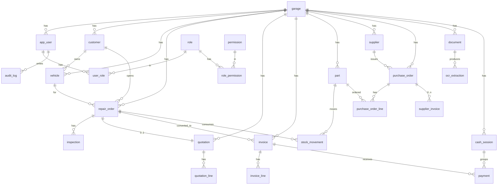

---

## 3. Tenancy and identity

### `garage`

| Column          | Type            | Notes                                                   |
|-----------------|-----------------|----------------------------------------------------------|
| id              | BIGINT PK       |                                                          |
| name            | TEXT NOT NULL   |                                                          |
| fiscal_id       | TEXT            | SIRET or local fiscal identifier                         |
| address         | JSONB           | structured: street, city, postal_code, country           |
| currency        | CHAR(3) NOT NULL| ISO 4217                                                 |
| locale          | TEXT NOT NULL   | e.g. `fr-FR`                                             |
| timezone        | TEXT NOT NULL   | IANA, e.g. `Europe/Paris`                                |
| settings        | JSONB           | per-garage CFG_* overrides                               |
| status          | TEXT NOT NULL   | CHECK in (`active`, `suspended`, `archived`)             |

### `app_user`

| Column        | Type             | Notes                                                |
|---------------|------------------|------------------------------------------------------|
| id            | BIGINT PK        |                                                      |
| garage_id     | BIGINT FK        | a user belongs to one garage; super-admins use NULL  |
| email         | CITEXT UNIQUE    |                                                      |
| full_name     | TEXT NOT NULL    |                                                      |
| password_hash | TEXT NOT NULL    | Argon2id                                             |
| status        | TEXT NOT NULL    | (`active`, `disabled`, `locked`)                     |
| last_login_at | TIMESTAMPTZ      |                                                      |
| failed_login_count | INT NOT NULL DEFAULT 0 | reset on success                              |
| locked_until  | TIMESTAMPTZ      | for lockout                                          |

### `role`, `permission`, `user_role`, `role_permission`

Standard RBAC junction tables. Permission codes are listed in [06_RBAC_DESIGN.md](06_RBAC_DESIGN.md). Roles are seeded but new roles can be added by admins.

---

## 4. Customer and vehicle

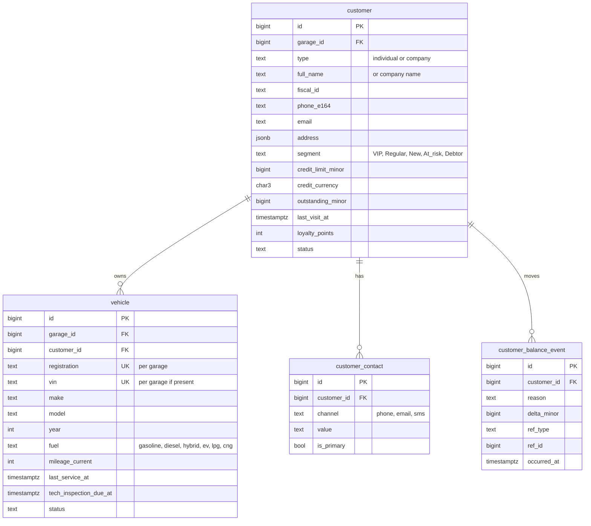

Notes:

- `customer_balance_event` is the ledger; `customer.outstanding_minor` is a denormalized cache refreshed on insert.
- `vehicle.registration` is unique per garage, not globally (a vehicle can move between garages).

---

## 5. Repair Order, Inspection, Workshop

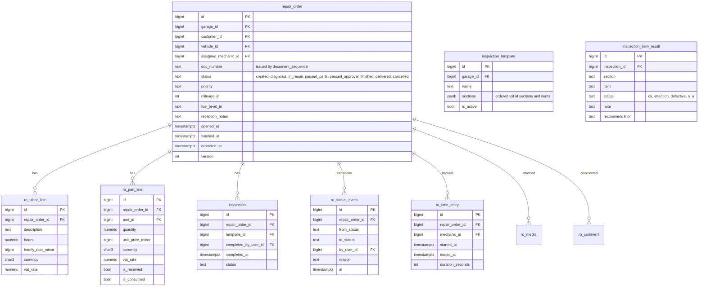

Notes:

- `ro_part_line.is_reserved` ↔ matching `stock_movement` of type `reservation`. On `in_repair`, reservation flips to `out` and `is_consumed=true`.
- `ro_status_event` is the canonical history; the current `status` on `repair_order` is denormalized for queries.

---

## 6. Inventory and Parts

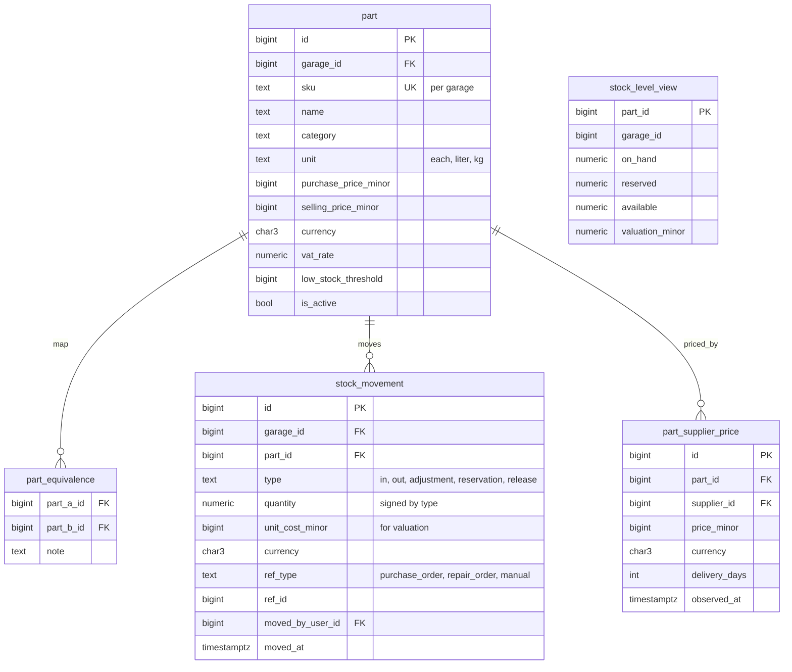

Notes:

- `stock_level_view` is a materialized view recomputed on movement insert via trigger or a small refresher.
- Valuation method (FIFO vs weighted average) is a per-garage setting; both are computable from the movement table.

---

## 7. Quotation and Invoice

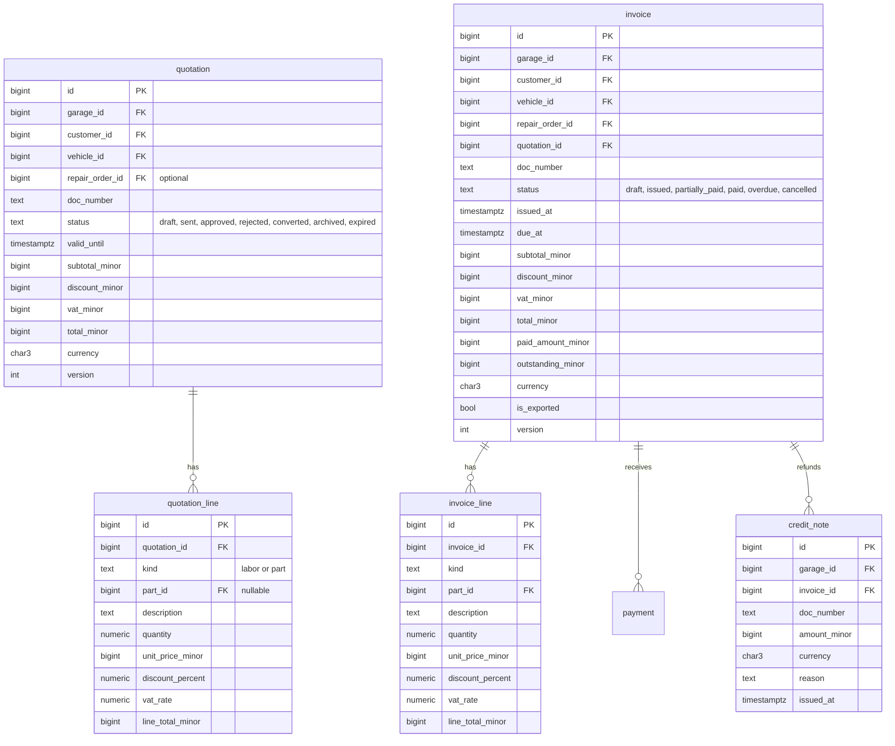

Notes:

- `doc_number` is generated by `document_sequence`; format from `CFG_DOCUMENT_NUMBER_FORMAT`.
- Once `is_exported=true`, invoice is immutable; cancellation must use a `credit_note`.

---

## 8. Payments and Cash Register

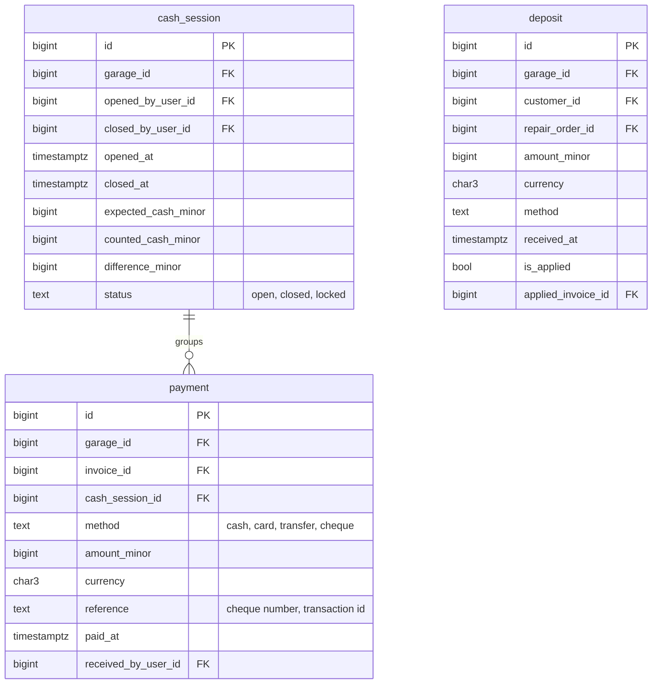

Notes:

- A `payment` always belongs to one open `cash_session`. Closing the session locks all child payments.
- `deposit.is_applied` flips on creation of the linked invoice; the application is a balance event, not a payment.

---

## 9. Supplier and Purchasing

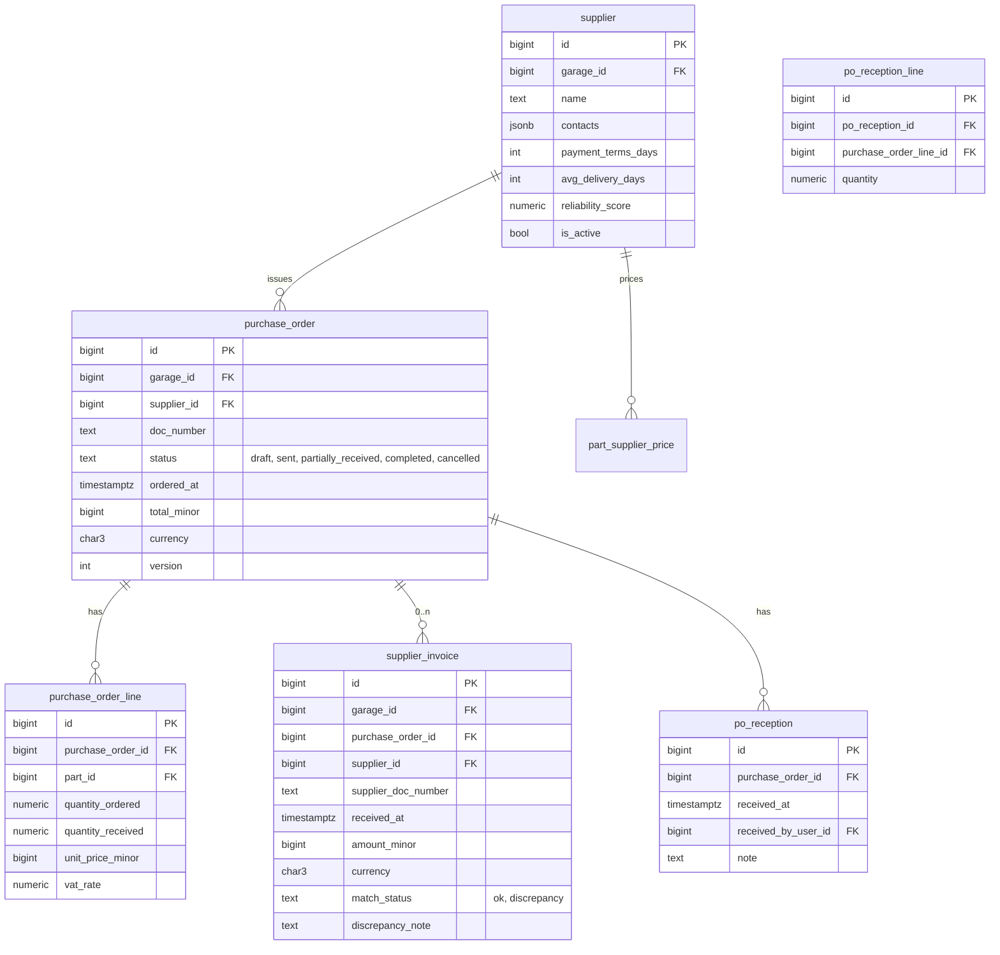

---

## 10. Documents (GED) and OCR

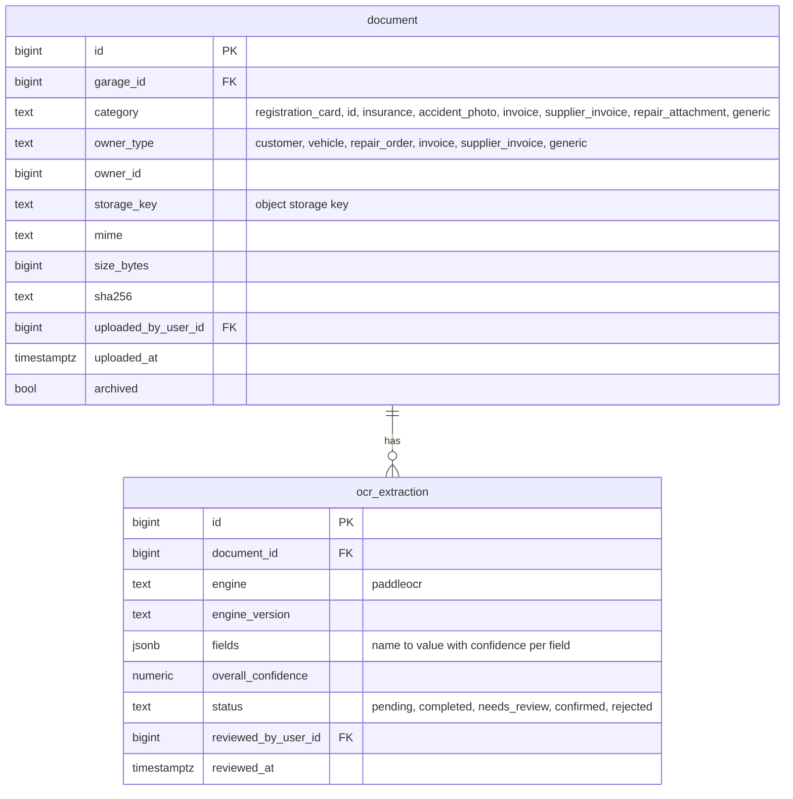

---

## 11. Notifications

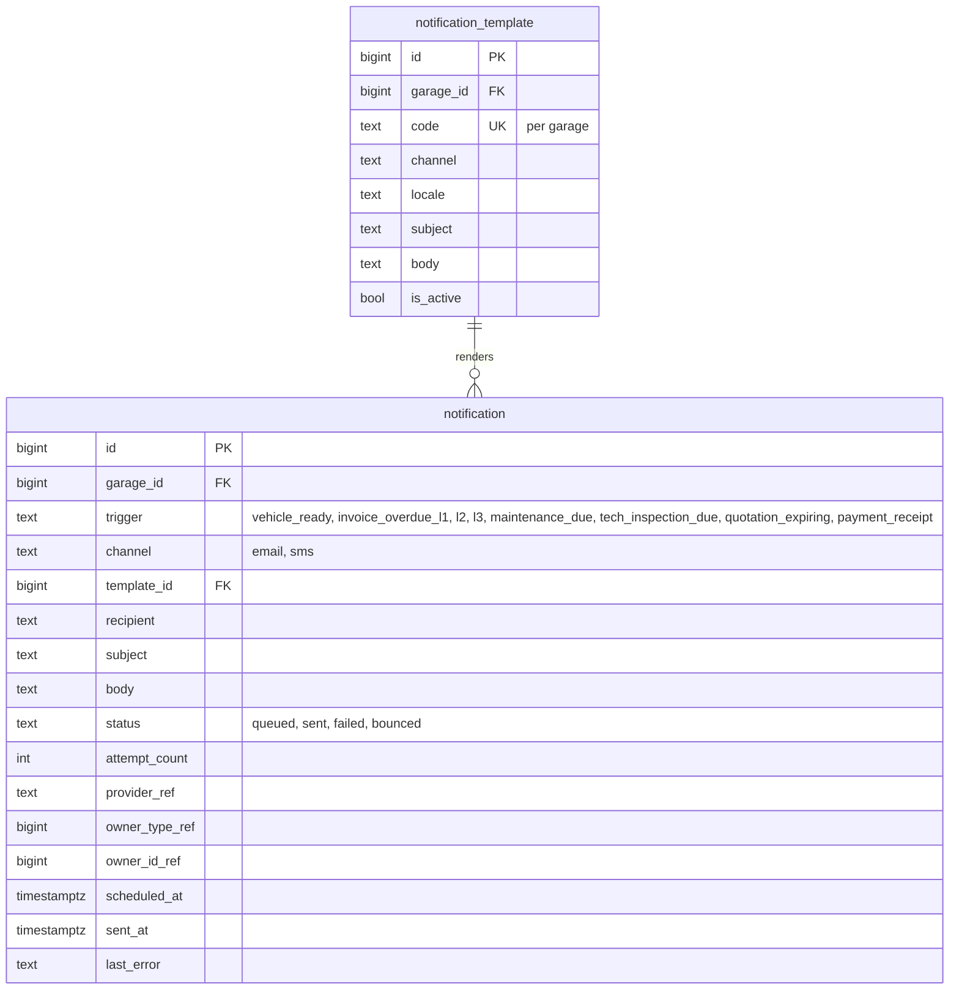

---

## 12. Audit log

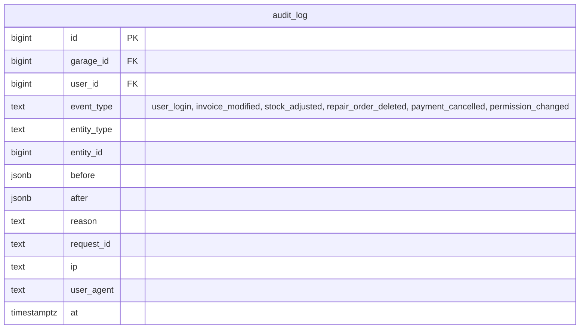

`audit_log` is append-only. Retention is per `CFG_RETENTION_AUDIT_YEARS` (default 10).

---

## 13. Reporting snapshots

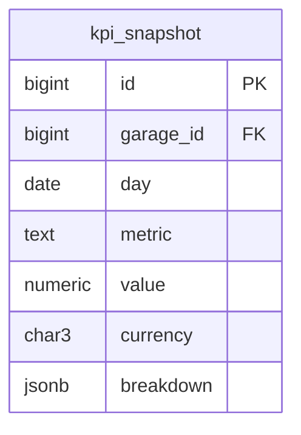

The KPI service writes a daily snapshot per metric; the dashboard reads from snapshots for trends and from live queries for today.

---

## 14. Indexing strategy (high level)

- Every FK has a single-column index.
- Hot lookups: `(garage_id, doc_number)` unique on quotation, invoice, repair_order, purchase_order. `(garage_id, vehicle.registration)` unique.
- Reporting hot paths: covering indexes on `(garage_id, issued_at)` for invoice, `(garage_id, opened_at)` for repair_order.
- Audit: `(garage_id, at)`, `(garage_id, entity_type, entity_id)`.
- Soft delete: partial index `WHERE deleted_at IS NULL` on hot tables.
- Full-text: `tsvector` GIN on `customer.full_name`, `vehicle.registration || ' ' || vehicle.vin`, `part.name`.

---

## 15. Migration policy

- All schema changes via Alembic migrations.
- Migrations are forward-only in production; downgrades exist only for local rollback during development.
- Any column added to a hot table is added with `NULL` first, backfilled, then made `NOT NULL` in a follow-up migration — never in one step on a live database.
- Index creation on hot tables uses `CREATE INDEX CONCURRENTLY`.
