# 10 — Deployment and DevOps

How the system is built, deployed, monitored, and recovered.

---

## 1. Environments

| Env             | Purpose                              | Data                            | Backed up |
|-----------------|--------------------------------------|---------------------------------|-----------|
| `local`         | developer machines                   | fixtures, ephemeral             | no        |
| `ci`            | continuous integration               | per-job ephemeral postgres      | no        |
| `staging`       | pre-production smoke and acceptance  | anonymized snapshot of prod     | weekly    |
| `stable-testing`| stable candidates for prod           | production-like                 | weekly    |
| `production`    | customer workloads                   | real data                       | daily     |

`stable-testing` mirrors the `stable-testing` branch (per [Context.md](Context.md)): only stable versions are deployed there.

---

## 2. Branching and release

- `main` — integration branch; CI green required to merge.
- Feature branches: `feat/<short-id>-<slug>` per [Context.md](Context.md) git conventions.
- `stable-testing` — fast-forwarded from `main` only when M-exit criteria are green and 48 hours of soak have passed without critical defects.
- Tags on `stable-testing` follow `vMAJOR.MINOR.PATCH` (semver). Tags drive container images.

### Commit conventions (per [Context.md](Context.md))

| Type         | Format                                            | Example                                                          |
|--------------|---------------------------------------------------|------------------------------------------------------------------|
| Feature      | `feat(<name>): <description> #<issue-id>`          | `feat(repair_order): add status transition api #123`            |
| Chore        | `chore(<name>): <description>`                    | `chore(deps): bump fastapi to 0.115.0`                          |
| Test         | `test: <description>`                             | `test: add edge cases for partial payment`                       |
| Performance  | `perf: <description>`                             | `perf: index audit_log on (garage_id, at)`                       |
| Docs         | `docs: <description>`                             | `docs: invoice issuance flow under docs/feature/invoice/`        |

Pre-commit hook enforces these.

---

## 3. CI pipeline

Every PR runs:

1. Lint (ruff, eslint).
2. Type check (mypy, tsc).
3. Unit + integration tests (pytest, vitest).
4. Coverage report + diff.
5. OpenAPI schema diff vs `stable-testing` (breaking-change gate).
6. Build container images with `APP_VERSION` and `GIT_SHA`.
7. Trivy scan on the images.
8. Generate test artefacts and post to PR.

Nightly on `main`:

- Playwright e2e against a docker-composed stack.
- k6 performance smoke.
- OWASP ZAP baseline.

---

## 4. CD pipeline

```mermaid
flowchart LR
    PR[Pull request green] --> Merge[Merge to main]
    Merge --> ImgMain[Container image main-SHA]
    ImgMain --> DeployStaging[Auto-deploy staging]
    DeployStaging --> Smoke[Smoke tests]
    Smoke --> Soak[Soak window]
    Soak --> Tag[Tag stable-testing]
    Tag --> ImgStable[Container image stable-X.Y.Z]
    ImgStable --> DeployStableTesting[Auto-deploy stable-testing env]
    DeployStableTesting --> ManualGate[Manual approval]
    ManualGate --> DeployProd[Deploy production]
    DeployProd --> PostDeploy[Post-deploy checks]
```

Rollback is one command (redeploy the previous image tag). Database migrations are forward-only; if a migration is unsafe, the application code is gated by a feature flag so it can be released before the data path lands.

---

## 5. Deployment topology

### 5.1 Single-host (default for one garage)

- One VM (or one bare metal box).
- Containers: nginx, fastapi, worker, redis, postgres, minio (optional).
- Postgres can be on the same VM at the assumed scale, but is moved to a managed service in any deployment serving multiple garages or considered business-critical.
- Backups push to off-host cloud storage.

### 5.2 Kubernetes (for multi-garage or scale)

- Deployments: `gms-api`, `gms-worker`, `gms-static`, `redis`, `postgres` (preferably managed), `minio` (preferably managed).
- HPA on `gms-api` and `gms-worker` based on CPU and queue depth.
- ConfigMap for non-secret config; Secret (sealed-secrets or external-secrets) for credentials.
- Ingress with TLS via cert-manager.

---

## 6. Backups and disaster recovery

Per [Context.md](Context.md) requirement: **daily cloud backup**.

| Asset           | Strategy                                                       | Target RPO | Target RTO |
|-----------------|----------------------------------------------------------------|------------|------------|
| PostgreSQL      | Daily base backup + continuous WAL archiving to cloud         | 15 min     | 1 hour     |
| Object storage  | Lifecycle rules + cross-region replication if available        | 24 h       | 4 h        |
| App config      | Tracked in Git; secrets in secrets manager (backed up)         | -          | 30 min     |
| Audit log       | Backed up with database; immutable from app layer              | 15 min     | 1 hour     |

A **quarterly restore drill** restores the latest backup into an isolated environment and runs a smoke suite to verify integrity.

---

## 7. Observability

| Signal     | Where                                                   |
|------------|---------------------------------------------------------|
| Logs       | Per-component files (JSON Lines), shipped to Loki/ELK.  |
| Metrics    | `/metrics` (Prometheus) on api and worker; Grafana.     |
| Traces     | OpenTelemetry, optional; enabled in staging from M5.    |
| Errors     | Sentry (or alternative) for frontend and backend.       |
| Uptime     | External pinger on `/health`.                            |
| Audit      | `audit_log` table, queryable in admin UI.                |

Standard dashboards: API latency p50/p95/p99, error rate, request rate; worker queue depth and processing time; Postgres connections, slow queries; Redis memory; storage usage.

---

## 8. Alerts

Alert rules (must be sized to actual thresholds in prod):

- API p95 > 2s for 10 minutes.
- API 5xx rate > 1% for 5 minutes.
- Worker queue depth > N for 10 minutes.
- Postgres connections > 80% of max.
- Disk usage > 80%.
- Backup did not complete in the last 26 hours.
- Audit log write failures > 0 in any 5-minute window.
- Unusual export volume (potential exfiltration).

All alerts ship to an on-call channel; admin email for severity 1.

---

## 9. Config and secrets

- All config keys documented in [01_SOFTWARE_CONCEPTION.md](01_SOFTWARE_CONCEPTION.md) §7.
- Env-only config: connection strings, secrets, service URLs.
- Db-stored config: per-garage CFG_* (VAT rates, thresholds, templates).
- Secrets manager required for: DB password, JWT signing key, SMTP password, SMS API key, object storage credentials, OCR model credentials if any.
- Rotation policies: secrets rotated at least annually; admin password reset enforced on rotation.

---

## 10. Operational runbooks

Each runbook lives under `docs/runbooks/`. Initial set:

- `runbook_db_failover.md`
- `runbook_restore_from_backup.md`
- `runbook_storage_full.md`
- `runbook_high_error_rate.md`
- `runbook_locked_admin_account.md`
- `runbook_security_incident.md`

Each runbook follows: symptoms → checks → mitigation → recovery → after-action.

---

## 11. Capacity and scaling

- Vertical first: at the assumed scale (one garage), the single-host topology is comfortable.
- Horizontal at the API and worker layer once multi-garage or load grows. Postgres is the bottleneck and the boundary at which managed service becomes mandatory.
- Read replicas can serve dashboard queries from M10 onward without code changes if the data layer abstraction is respected.

---

## 12. Compliance and retention

- Invoice retention: 10 years (configurable).
- Audit retention: 10 years (configurable).
- Customer PII retention: 3 years after last activity (configurable), subject to GDPR or local equivalent erasure on request.
- Backup retention: 30 days short-term, 1 year long-term snapshots.
- All retention windows are configuration, not hard-coded.
