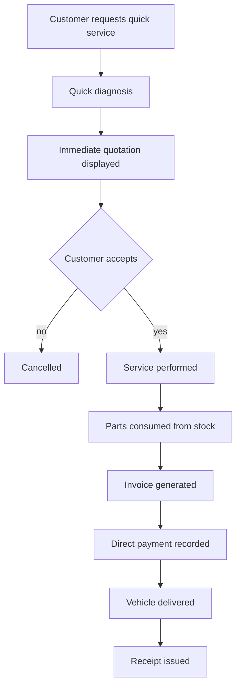

# Workflow — Quick Service

Short-cycle services such as oil change, battery replacement, tire service.

No full Repair Order workflow is required; the service may still create a minimal OR for history and KPI tracking.
