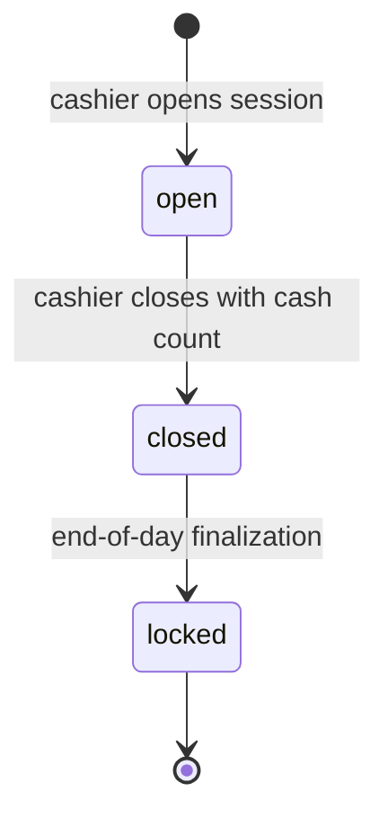

# State Machine — Cash Session

Once `locked`, all payments in the session are immutable except via credit note. Differences between expected and counted cash are stored on the session row with a reason.
