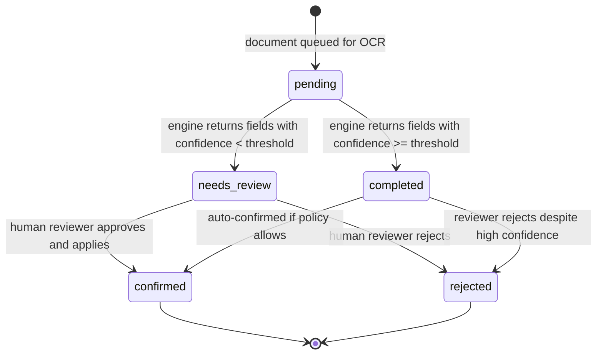

# State Machine — OCR Extraction

Default policy: even `completed` extractions require human confirmation for `registration_card` and `id` categories. Auto-confirmation is opt-in per category by config.
