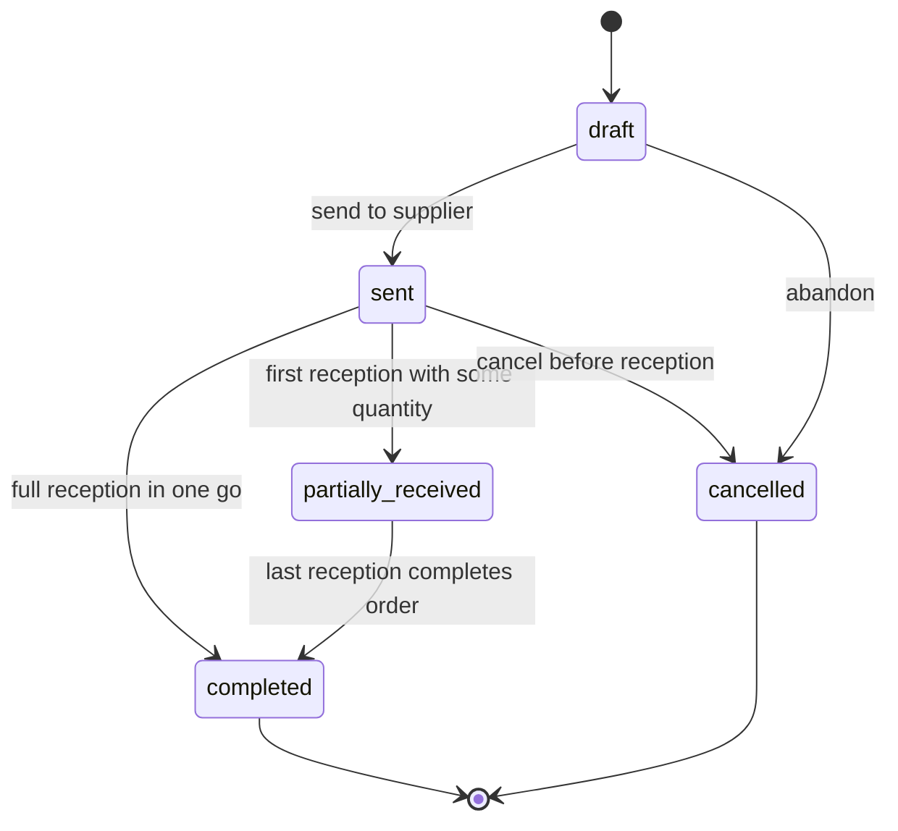

# State Machine — Purchase Order

Receptions update `purchase_order_line.quantity_received`. The PO becomes `completed` when every line's received equals ordered (or supplier-shortship is closed by admin).
