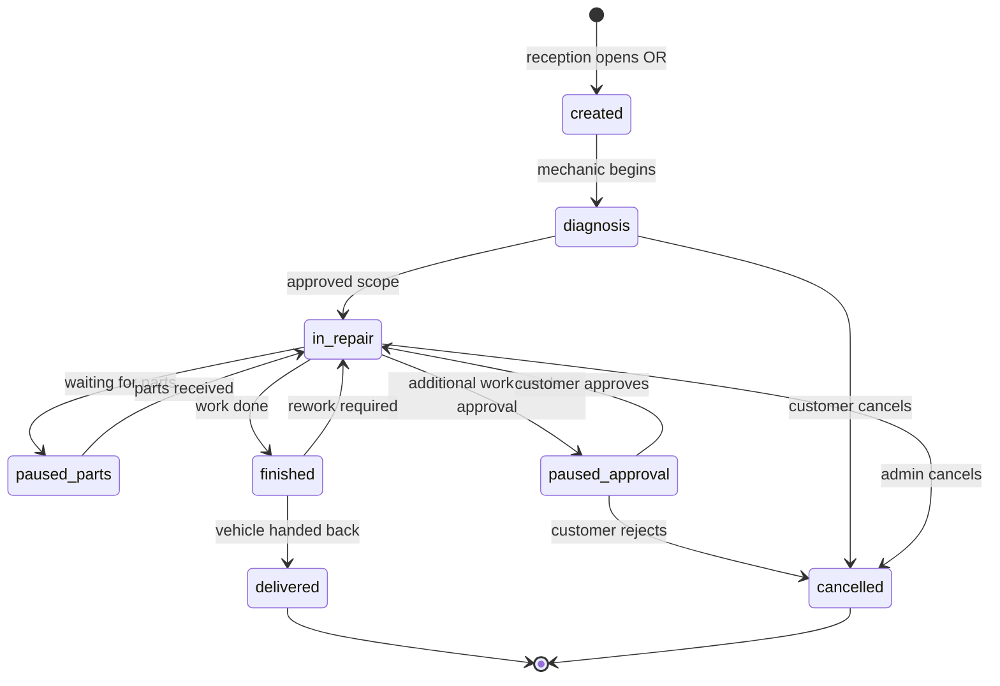

# State Machine — Repair Order

Transitions are gated by permission `repair_order.transition` (cancel requires `repair_order.transition.cancel`). Every transition writes a `ro_status_event` row and an `audit_log` entry.
