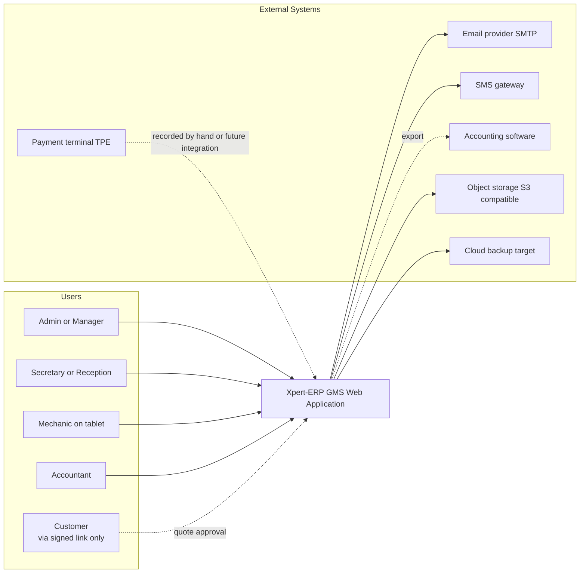

# System Context (C4 Level 1)

The customer is not a logged-in user of the system. They interact with Xpert-ERP only via single-use signed links sent in notifications (quotation approval, optional receipt or status link). All other actors are authenticated and bound to a `garage_id` via their role.
