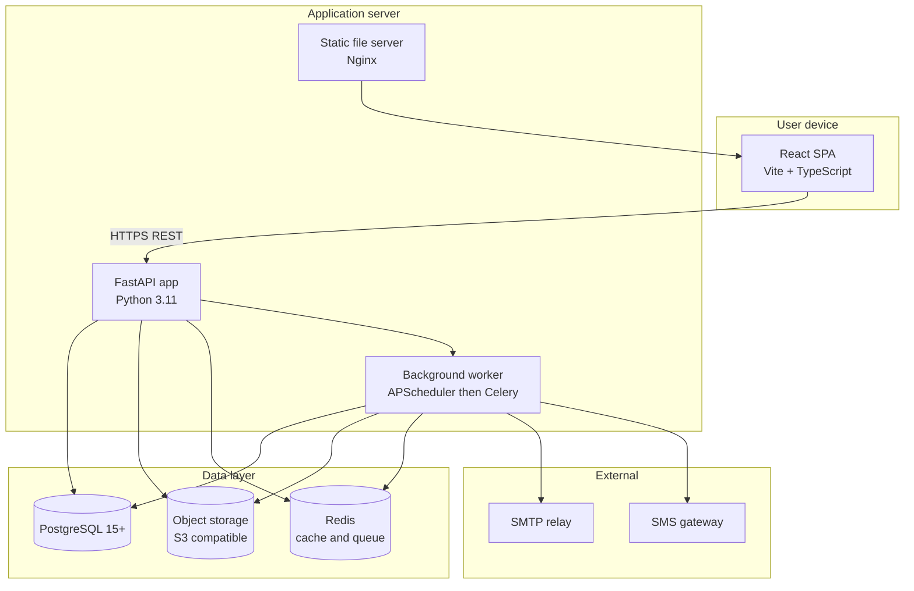

# Container View (C4 Level 2)

## Container responsibilities

- **React SPA** — UI, routing, optimistic updates, file upload with resume.
- **FastAPI app** — REST API, authn/authz, transactions, audit and logging.
- **Background worker** — OCR, PDF batches, scheduled reminders, KPI snapshots, backups.
- **PostgreSQL** — transactional source of truth.
- **Object storage** — photos, videos, PDFs, scanned documents.
- **Redis** — cache, sessions, deny-list, Celery broker (post-M8).
- **Static server (Nginx)** — serves the built SPA, terminates TLS, reverse-proxies the API.
