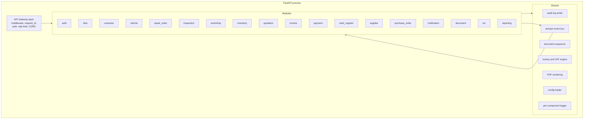

# Backend Components (C4 Level 3)

Each module is a self-contained package: `router.py`, `schemas.py`, `service.py`, `repository.py`, `models.py`, `events.py`, `permissions.py`, `config.py`, `exceptions.py`, `tests/`.

Modules talk to one another only through (a) service calls — same transaction — or (b) domain events — eventual consistency. They never reach into another module's models or repository.
