# Frontend Components (C4 Level 3)

```mermaid
flowchart TB
    subgraph SPA[React SPA]
        Router[Router]
        subgraph Shell
            Layout[App layout shell]
            Auth[Auth context]
            Perms[Permission gate]
            Toast[Notifications]
        end
        subgraph Features
            FCust[customer feature]
            FVeh[vehicle feature]
            FRO[repair_order feature]
            FInv[inventory feature]
            FQuot[quotation feature]
            FInvo[invoice feature]
            FPay[payment feature]
            FCash[cash_register feature]
            FSup[supplier feature]
            FInsp[inspection feature]
            FRep[reporting feature]
            FAdmin[admin feature]
        end
        subgraph Shared[Shared infra]
            API[API client<br/>Axios + interceptors]
            Cache[Query cache<br/>TanStack Query]
            Forms[Form layer<br/>React Hook Form + Zod]
            I18n[i18n catalog]
            Theme[Theme tokens]
            Offline[Offline buffer<br/>Dexie / IndexedDB]
        end
        Router --> Shell
        Shell --> Features
        Features --> Shared
    end
```

The mechanic tablet view (`FInsp` and parts of `FRO`) is the only feature that uses the `Offline` buffer in the MVP; the rest of the app assumes online connectivity.
