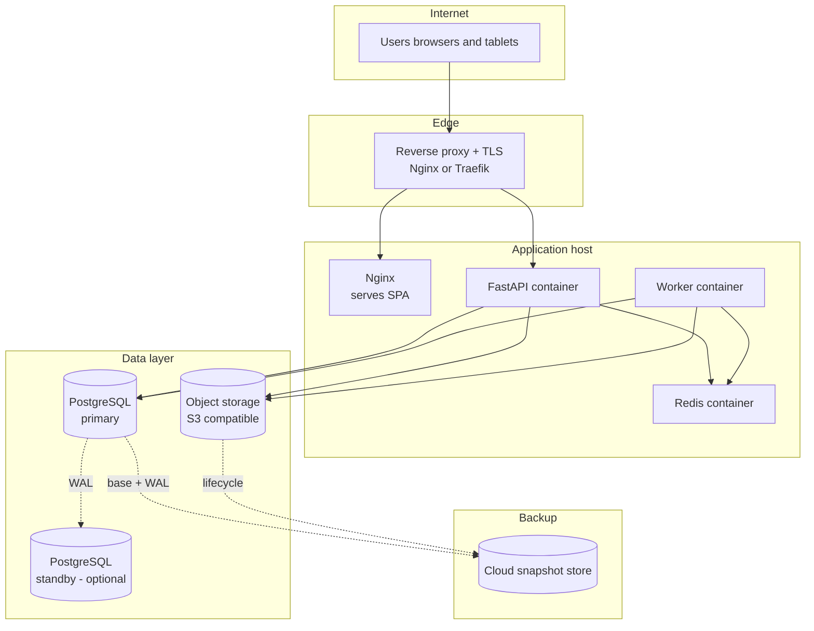

# Deployment View (C4 Level 4)

This is the single-host topology — the default for one garage. The same containers run on Kubernetes for multi-garage or scale; see [03_ARCHITECTURE.md](../../03_ARCHITECTURE.md) §5.2.
