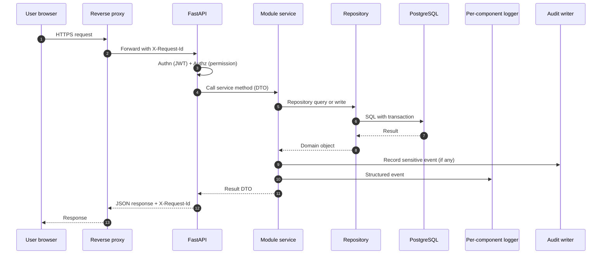

# Cross-Cutting: End-to-End Request Flow with Logging and Audit

Every request carries an `X-Request-Id` (generated at the proxy if absent). The id is bound to the structured logger and to every audit log entry written during the request, making post-hoc correlation cheap.
